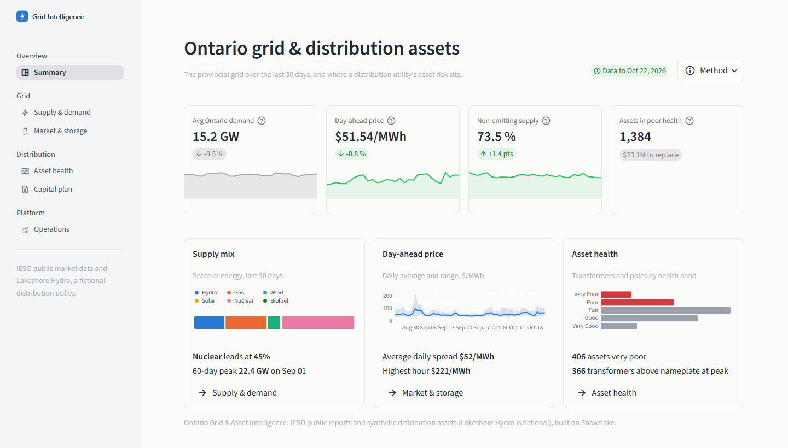
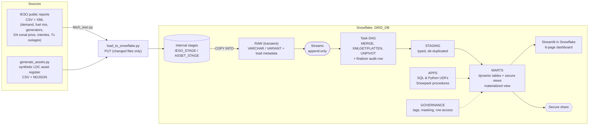
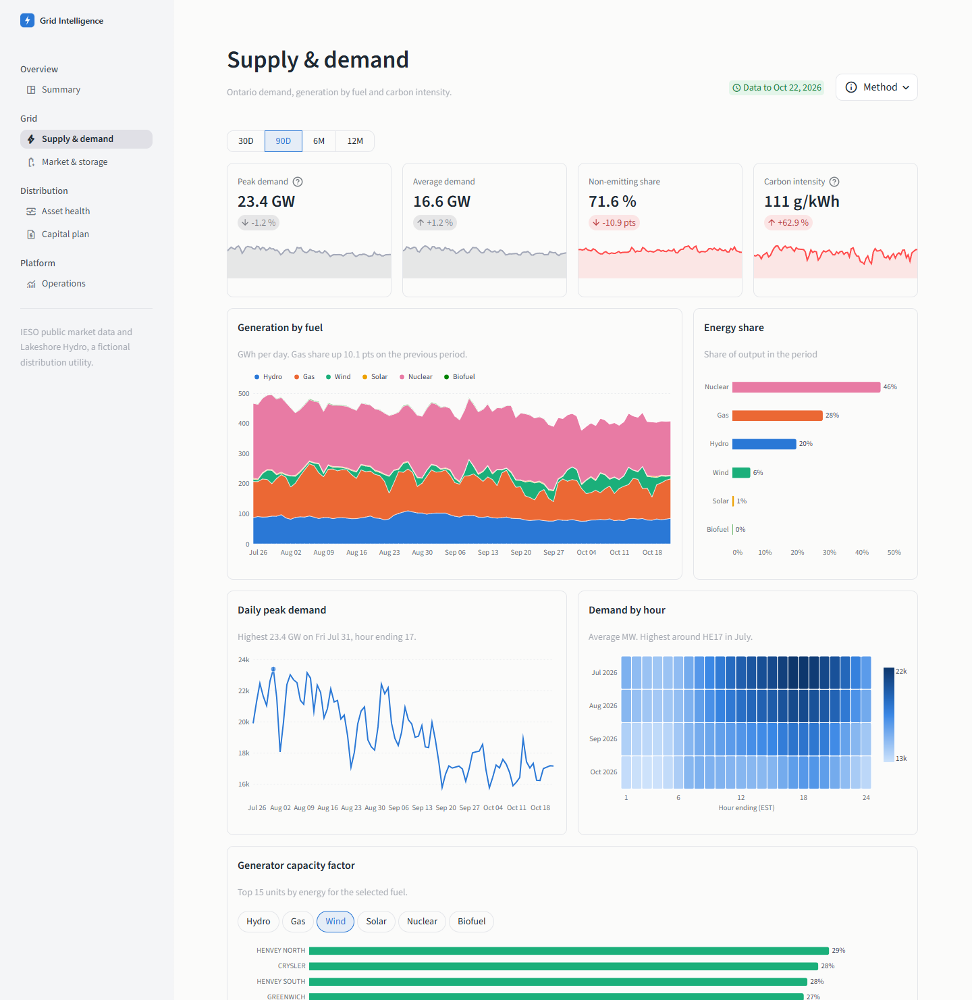
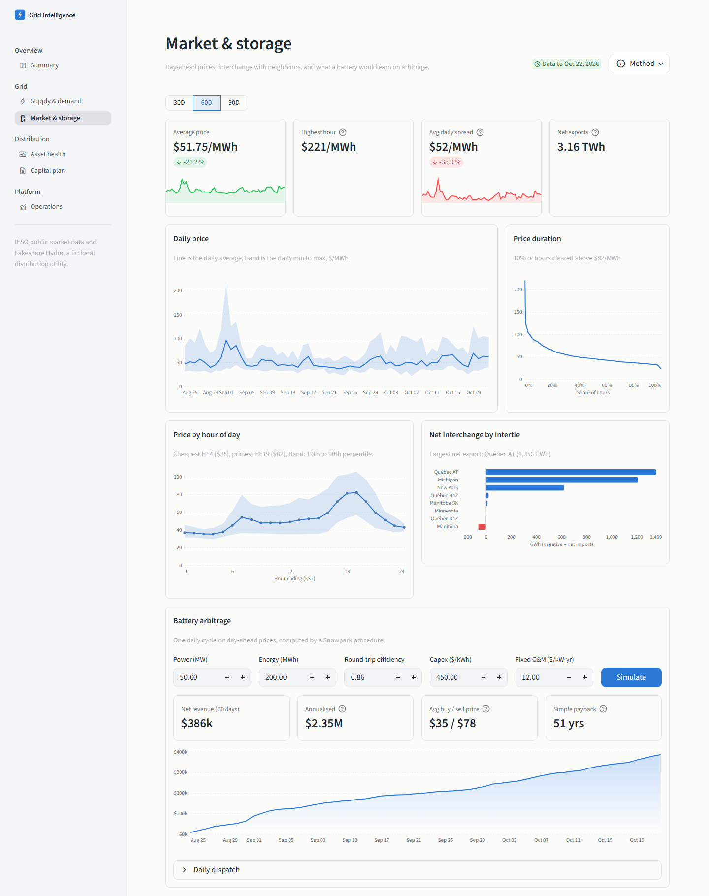
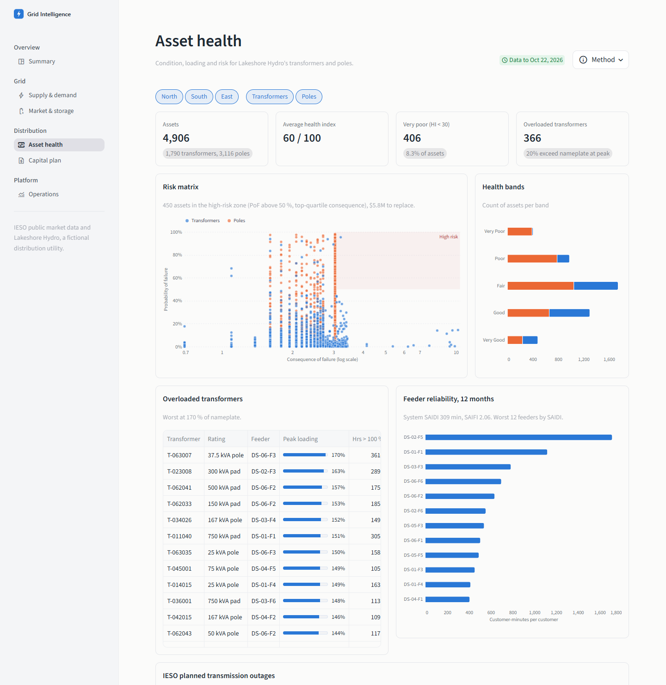
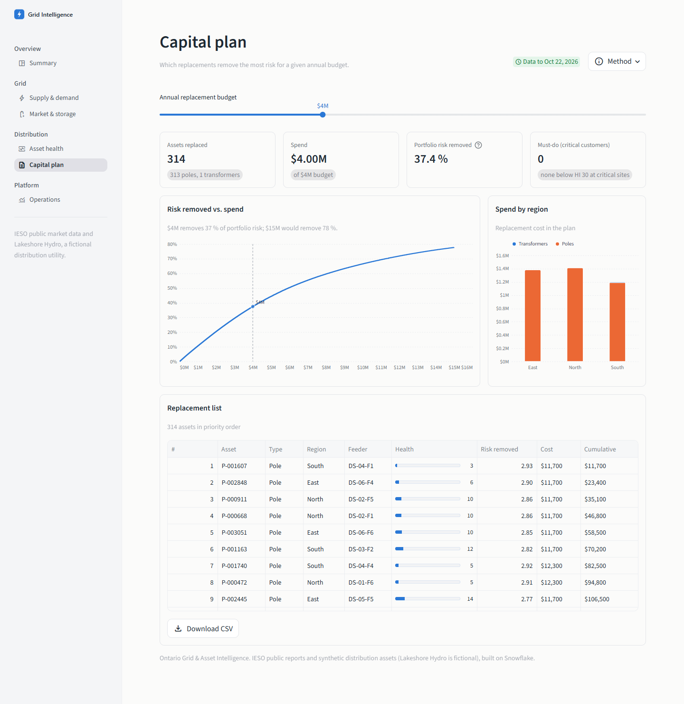

# Ontario Grid & Asset Intelligence

A Snowflake data platform for grid analytics and distribution asset planning


An end-to-end Snowflake project from a power-systems engineer's point of view. It takes **real public
IESO market and generation data** and a **synthetic distribution asset register** for a fictional
Ontario LDC. From those it answers three questions a utility planning team actually asks:

1. **Grid:** How is Ontario's supply mix, demand and carbon intensity evolving?
2. **Storage:** What would a battery energy storage system (BESS) earn from day-ahead price arbitrage
   under the post-Market Renewal Ontario Zonal Price?
3. **Capital plan:** Which transformers and poles should be replaced first? Assets are ranked by
   condition-based risk (ISO 55000 style) and fitted to a capital budget.

Everything runs inside Snowflake: ingestion, transformation, governance, the Python analytics and the
dashboards (Streamlit in Snowflake).



## Results at a glance

Built and verified on a live Snowflake trial account (Enterprise edition, AWS us-east-2).

| | |
|---|---|
| **Data volume** | 15.8k hours of Ontario demand, 1.59M generator-hours, 15.6M modelled transformer-hours, 4,906 assets scored |
| **Pipeline** | 9-task DAG fed by streams, 6 dynamic tables, 12/12 data-quality checks passing |
| **Cost** | About 0.7 credits to build everything from scratch on XS/S warehouses |
| **Grid finding** | Over the last 30 days, 73% of Ontario's supply was non-emitting, with demand peaking around HE17-19 |
| **Storage finding** | A 50 MW / 200 MWh battery earns about $2.35M a year on day-ahead arbitrage, a 51-year payback at $450/kWh. Arbitrage alone doesn't fund storage, so capacity and ancillary revenue are needed |
| **Asset finding** | 406 assets are in very poor health. A $4M budget removes 37% of portfolio risk, mostly by replacing cheap, very-poor wood poles |

---

## Architecture



| Layer | Contents | Load pattern |
|---|---|---|
| `RAW` (transient) | Files as delivered: CSV columns as VARCHAR, XML / JSON as VARIANT, plus `_source_file`, `_loaded_at` | IESO: incremental COPY. Assets: TRUNCATE + COPY |
| `STAGING` | Typed hourly facts (`DEMAND_HOURLY`, `FUEL_HOURLY`, `GEN_HOURLY`, `DA_PRICE_HOURLY`, `INTERTIE_HOURLY`, `TX_OUTAGE_EQUIPMENT`, `XFMR_LOADING_HOURLY` ~16M rows) and asset dimension views | Streams -> task DAG -> MERGE |
| `MARTS` | `FACT_GRID_HOURLY/DAILY`, `FACT_GENERATOR_DAILY`, `XFMR_LOADING_SUMMARY`, `ASSET_RISK`, `FEEDER_RELIABILITY_MONTHLY`, plus a secure `V_*` view over each | Dynamic tables (target lag) |
| `APPS` | `ASSET_HEALTH_INDEX` (Python UDF), `XFMR_FULL_LOAD_AMPS`, `VOLTAGE_DROP_PCT`, `SP_BESS_ARBITRAGE`, `SP_CAPITAL_PLAN`, Streamlit app | |
| `GOVERNANCE` | Tags, tag-based masking policy, row access policy and entitlement table, pipeline run log | |

---

## SnowPro Core coverage

Each exam domain is exercised on purpose. [docs/snowpro_concept_map.md](docs/snowpro_concept_map.md)
has the full list with line-level pointers.

| Domain | Where it's demonstrated |
|---|---|
| **Architecture and compute** | Three workload-isolated warehouses. 60 s auto-suspend. `WH_BI` is multi-cluster with an ECONOMY scaling policy. Resource monitor with notify / suspend / suspend-immediate triggers. Query acceleration. [00](setup/00_account_setup.sql), [09](setup/09_performance.sql) |
| **Account access and security** | Custom role hierarchy rolled up to SYSADMIN, with USERADMIN / SECURITYADMIN separation of duties. Future grants. Managed access schema. [00](setup/00_account_setup.sql), [01](setup/01_databases_schemas.sql) |
| **Data governance** | Object tags. One **tag-based** masking policy whose behaviour varies by tag value (names fully masked, phone numbers partially). Row access policy driven by an entitlement table. Secure views. ACCESS_HISTORY. [08](setup/08_governance.sql) |
| **Data loading** | Named file formats (CSV, XML, NDJSON, header-parsed CSV). Internal stages with directory tables. PUT. COPY with transformations, PATTERN, ON_ERROR variants, METADATA$ columns, MATCH_BY_COLUMN_NAME. Load-metadata de-duplication vs. TRUNCATE. LOAD_HISTORY. [02](setup/02_file_formats_stages.sql), [04](setup/04_copy_into.sql) |
| **Semi-structured data** | Nested IESO XML (`XMLGET`, `"@"` / `"$"`, multi-level `LATERAL FLATTEN`). JSON inspections with nested arrays. `SPLIT` / `ARRAY_SLICE` for a schema-drifting CSV. [05](setup/05_streams_tasks.sql) |
| **Data transformation** | Append-only streams with `SHOW_INITIAL_ROWS`. Task DAG with `WHEN SYSTEM$STREAM_HAS_DATA`, a finalizer task and CRON in a time zone. MERGE upserts. UNPIVOT. QUALIFY. Dynamic tables (DOWNSTREAM lag, FULL refresh mode). SQL and Python UDFs. Snowpark stored procedures returning tables. [05](setup/05_streams_tasks.sql)-[07](setup/07_marts_dynamic_tables.sql) |
| **Performance** | Clustering key with `SYSTEM$CLUSTERING_INFORMATION` and suspended reclustering. Pruning in the Query Profile. Materialized view. Search optimization with a cost estimate. Result / warehouse / metadata caches. [09](setup/09_performance.sql) |
| **Data protection and sharing** | Time Travel (`BEFORE(STATEMENT => ...)`) to undo a bad UPDATE. UNDROP. `SWAP WITH`. Zero-copy clone of the whole database for DEV. Transient vs. permanent, and Fail-safe. Secure data share and reader accounts. [10](setup/10_protection_cloning.sql), [11](setup/11_data_sharing.sql) |
| **Observability and data quality** | ACCOUNT_USAGE metering and query history. TASK_HISTORY. DYNAMIC_TABLE_REFRESH_HISTORY. TABLE_STORAGE_METRICS. SQL data quality suite plus Data Metric Functions. [90](setup/90_data_quality.sql), [Platform Ops page](streamlit/views/5_Platform_Ops.py) |

---

## The engineering behind the numbers

- **Fuel mix and carbon:** Hourly output by fuel comes from the IESO `GenOutputbyFuelHourly` XML.
  Carbon intensity is an estimate: gas output times 0.40 tCO2e/MWh, divided by total transmission-connected output.
- **Capacity factor:** Output divided by capability for dispatchable units, or by available capacity for wind and
  solar. Source: `GenOutputCapabilityMonth`, per generator and per hour.
- **BESS arbitrage** (`SP_BESS_ARBITRAGE`): For each day it searches every split hour. The battery
  charges in the cheapest *n* hours before the split and discharges in the most expensive *n* hours
  after it. Round-trip losses apply to discharge, and the battery idles if the spread doesn't cover
  them. The result is energy-arbitrage revenue only, with no capacity or ancillary-service stacking.
- **Transformer loading:** Each synthetic transformer's hourly load is its connected peak kVA x the
  **real Ontario demand shape** x a time-of-day factor for its load class x deterministic noise from
  `HASH()`. This yields about 16M rows a year, a realistic scale for clustering and search
  optimization.
- **Health index** (`ASSET_HEALTH_INDEX`, Python UDF): A weighted degradation score built from four
  inputs. Missing inputs re-normalise the weights.
  - Age vs. expected life.
  - Loading stress, based on peak % of nameplate and hours above 100% (insulation ageing per
    IEEE C57.91).
  - Inspection condition score (1-5).
  - For poles, resistograph remaining strength (poles are typically replaced below 60-67%).
- **Risk:**
  - Probability of failure is a logistic function of the health index (an HI of 35 gives 50%).
  - Consequence of failure is ln(1 + customers) x (1 + 2 x critical customers).
  - Risk = PoF x CoF. Risk reduction assumes a new asset has about 2% PoF.
- **Capital plan** (`SP_CAPITAL_PLAN`): Critical-customer assets in very poor health are mandatory and
  go first. After that, assets are picked greedily by risk reduction per dollar within the budget. Every
  run is logged to `MARTS.CAPITAL_PLAN_RUNS`.
- **Reliability:** SAIFI, SAIDI and CAIDI per IEEE 1366, counting unplanned sustained interruptions
  with no major-event-day exclusion.

---

## Run it

**Prerequisites:** Python 3.11+, and a Snowflake account with ACCOUNTADMIN. A
[free 30-day trial](https://signup.snowflake.com/) is Enterprise edition, so every feature here works.

```bash
python -m venv .venv
.venv\Scripts\activate            # Windows  (macOS/Linux: source .venv/bin/activate)
pip install -r requirements.txt

cp config.example.toml config.toml   # then fill in account + login name
python ingest/make_keypair.py        # key-pair auth; run the SQL it prints in Snowsight

python ingest/fetch_ieso.py          # ~12 months of IESO reports  -> data/raw/ieso/
python ingest/generate_assets.py     # synthetic asset register    -> data/raw/assets/
python ingest/load_to_snowflake.py --all
```

`--all` runs in dependency order:
1. Account, database and RAW setup (00-03).
2. Upload files and run COPY INTO (04).
3. Create streams, tasks, UDFs and procedures (05-06).
4. Run the task DAG and wait for it to finish.
5. Create the marts (07), with dynamic tables initialised from the loaded data.
6. Governance, performance and sharing (08, 09, 11).
7. Upload and create the Streamlit app (12).

Open it in **Snowsight > Projects > Streamlit > GRID_INTELLIGENCE**.

**Authentication:** trial accounts have no SSO, so browser login fails. `make_keypair.py` sets up key-pair
(JWT) auth instead. In `config.toml`, `user` must be your *login name* (what you type to sign in), which can
differ from `CURRENT_USER()`.

**Daily refresh:** The DAG is scheduled for 08:30 America/Toronto. To pull new data by hand:

```bash
python ingest/fetch_ieso.py && python ingest/load_to_snowflake.py
```

Only changed files are uploaded. COPY skips files it has already loaded, and the MERGE de-duplicates
re-published current-year files. IESO keeps daily price files for only about 90 days, so each refresh
grows the warehouse's history beyond that window.

**Walkthrough scripts:** Run these one statement at a time in a Snowsight worksheet:

- [10_protection_cloning.sql](setup/10_protection_cloning.sql): Time Travel, UNDROP, SWAP and a DEV clone
- [90_data_quality.sql](setup/90_data_quality.sql): data quality checks and DMFs
- [08_governance.sql](setup/08_governance.sql): the same query run as three roles

**Run the dashboard locally:** `streamlit run streamlit/streamlit_app.py` uses `config.toml`.

**Tear down:** [99_teardown.sql](setup/99_teardown.sql) removes everything the project created.

**Tests:** `pytest` covers generator determinism, referential integrity and value ranges.

---

## Dashboards

Every page follows the same layout:
1. A header with a data-freshness badge and a **Method** popover.
2. Four KPI cards with sparklines and change against the previous period.
3. Chart cards, each with a one-line takeaway computed from the data.

| Page | Shows |
|---|---|
| Summary | Headline KPIs, plus supply-mix, price and asset-health cards that link to the detail pages |
| Supply & demand | Generation by fuel, energy share, daily peak, hour x month demand heatmap, generator capacity factors |
| Market & storage | Daily price band, price-duration curve, price by hour of day, net interchange, interactive BESS simulator |
| Asset health | PoF x CoF risk matrix with high-risk zone, health bands, overloaded transformers, feeder SAIDI, IESO planned Tx outages |
| Capital plan | Budget slider, risk-removed vs. spend curve, spend by region, downloadable replacement list |
| Operations | Credits by warehouse, task runs, dynamic tables, storage by table, slowest queries |

| | |
|---|---|
|  |  |
|  |  |

---

## Lessons from the live deployment

These came up when the scripts first ran against a real account. Each is now handled in the code:

- **Secondary roles hide governance.** New users default to `DEFAULT_SECONDARY_ROLES = ('ALL')`, so a
  user testing as `GRID_VIEWER` still carried ACCOUNTADMIN, and masking looked broken.
  `USE SECONDARY ROLES NONE` showed the policies working as designed
  ([08_governance.sql](setup/08_governance.sql)).
- **Data quality caught a real IESO anomaly.** On 2025-04-08 HE16, reported generation dropped 4.2 GW
  for one hour, and IESO had flagged 7 of 8 fuels as suspect telemetry. The marts now carry IESO's
  quality flags, and the supply-demand check judges only clean hours.
- **Incremental by design.** When no new data arrives, the stream-gated tasks skip themselves and spend
  no compute, while the finalizer still writes its audit row.
- **IESO retention.** IESO deletes daily price files after about 90 days. Because STAGING is upserted
  rather than rebuilt, the warehouse keeps history that the source no longer publishes.
- **Big XML fits in a VARIANT.** IESO's yearly fuel-mix XML (6-7 MB) loads as one row per document with
  `STRIP_OUTER_ELEMENT`, then three nested `LATERAL FLATTEN`s turn it into hourly rows.

---

## Repository layout

```
setup/      numbered SQL scripts: 00-12 build the platform, 90 data quality, 99 teardown
ingest/     fetch_ieso.py, generate_assets.py, load_to_snowflake.py, make_keypair.py
streamlit/  Streamlit in Snowflake app (streamlit_app.py router + views/ + ui.py + common.py)
tests/      pytest for the asset generator
docs/       architecture, data dictionary, SnowPro concept map, screenshots
```

## Data and disclaimers

- **IESO data:** Public reports from [reports-public.ieso.ca](https://reports-public.ieso.ca/public/),
  used for analysis and education. IESO hours are hour-ending, in EST, with no daylight saving time.
- **Lakeshore Hydro Distribution** is fictional. All asset, customer, inspection and outage data is
  generated. Critical facility names are invented, and phone numbers use the reserved 555-01xx range.
- Unit costs, emission factors and health-index weights are indicative, chosen for demonstration.
  They are not engineering or investment advice.

---

## Author

**Mazen Damdoum**, Electrical Engineer (EIT, power systems). MEng in Electric Power Engineering at the
University of Waterloo.

[LinkedIn](https://www.linkedin.com/in/mazendamdoum) | [GitHub](https://github.com/mazendamdoum)

Released under the [MIT License](LICENSE).
